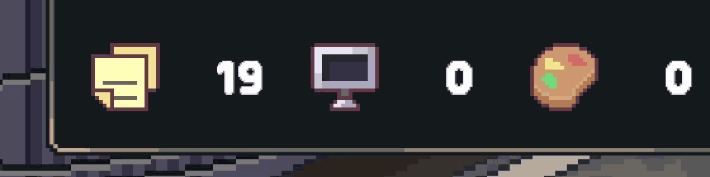

# PixelPang — 도트 '팡' 이펙트 시안 v1

스탯 아이콘(기획/개발/아트/버그)이 HUD로 흡입된 순간 터지는 도트 섬광 + 링 이펙트.
레퍼런스: EXP 코인이 아이콘으로 빨려들어간 뒤 하얀 섬광 → 링 확산 → 반짝이 소멸.

> 아직 Unity에 미적용(시안 공유용). 확정 후 `Assets/Effects/PixelPang/` 로 이전 예정.



## 사양
- 캔버스 32×32 도트 (HUD 아이콘 16×16의 2배), 10프레임 @ 24fps ≈ 0.42초
- 역할별 색: 기획 노랑 / 개발 하늘 / 아트 주황 / 버그 빨강 (HUD 아이콘 색 기준)
- 흐름: 섬광(0–2) → 흰 링(3–4) → 역할색 링(5) → 점선 흩어짐(6–7) → 반짝이 잔상(8) → 빈 프레임(9)

## 파일
| 경로 | 내용 |
|---|---|
| `sheets/pang_<role>.png` | 가로 스프라이트 시트 (320×32, 32px 셀 10장) |
| `preview/in_hud.gif` | 실제 인게임 HUD 위 합성 재생 |
| `preview/in_hud.png` | 위 GIF의 프레임별 정지 컷 |
| `preview/strip.png` | 4색 전체 프레임 (6배 확대) |
| `gen_pang.py` | 시트 생성 스크립트 |
| `preview_pang.py` | 미리보기 생성 스크립트 |

## 다시 생성
```bash
pip install pillow
python gen_pang.py sheets
python preview_pang.py sheets <인게임 1080p 프레임.png> none preview
```

## Unity 임포트 설정 (적용 시)
Texture Type: Sprite (2D and UI) / Sprite Mode: Multiple (Grid 32×32) / Filter: Point / Compression: None
